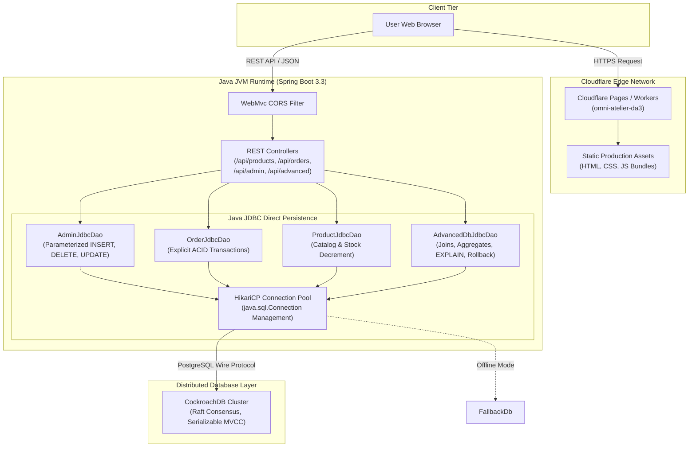

# System Architecture & Technical Specification

## 1. Architectural Overview

**OmniMarket Atelier (Digital Assignment 3)** is a distributed, full-stack Relational Database Management System application built with a decoupled architecture:

1. **Frontend Presentation Tier:** A lightweight, high-performance web interface built with modern modular JavaScript and Vite, deployed on **Cloudflare Pages / Edge Infrastructure**.
2. **Application & Business Logic Tier:** A **Java 17 / Spring Boot 3.3** RESTful API service running on a dedicated JVM runtime platform.
3. **Data Access Layer:** Direct **Java JDBC (`java.sql.*`)** utilizing parameterized `PreparedStatement`, transaction demarcation with `setAutoCommit(false)`, `commit()`, and `rollback()`, managed by the **HikariCP** high-concurrency connection pool.
4. **Relational Database Tier:** A normalized distributed schema deployed on **CockroachDB** (a local single-node cluster via `crdb-cli.cmd`, or CockroachDB Cloud).

---

## 2. Component Architecture Diagram



---

## 3. Layered Design & Separation of Concerns

### 3.1 REST Controller Layer (`com.omnimarket.da3.controller`)
- Exposes typed REST endpoints accepting JSON request bodies.
- Sanitizes incoming request inputs using Jakarta Validation annotations (`@Valid`, `@NotNull`, `@NotBlank`).
- Employs `GlobalExceptionHandler` (`@RestControllerAdvice`) to intercept exceptions, returning clean status codes (`200 OK`, `201 CREATED`, `400 BAD REQUEST`, `403 FORBIDDEN`, `404 NOT FOUND`) without exposing internal stack traces or connection strings.

### 3.2 JDBC DAO Layer (`com.omnimarket.da3.dao`)
- Strictly adheres to course requirements by utilizing standard `java.sql.*` classes directly without ORM overhead.
- All DML and DDL operations utilize `PreparedStatement` to eliminate SQL injection vulnerabilities.
- Handles explicit transaction lifecycles:
  ```java
  conn.setAutoCommit(false);
  try {
      // Step 1: Insert Order
      // Step 2: Insert Items & Decrement Stock
      // Step 3: Insert Settlement
      conn.commit();
  } catch (SQLException e) {
      conn.rollback();
      throw e;
  }
  ```

### 3.3 Connection Pool (`com.zaxxer.hikari.HikariDataSource`)
- Configured with optimal connection limits: `maximum-pool-size = 10`, `minimum-idle = 2`, `idle-timeout = 30000ms`, `connection-timeout = 15000ms`.
- Manages connection lifecycle and validates connection health using `conn.isValid(2)`.

---

## 4. Evaluator Feature Matrix

| Feature | Endpoint | JDBC Implementation | Evaluation Purpose |
| :--- | :--- | :--- | :--- |
| **Action 1: Insert** | `POST /api/admin/insert` | `PreparedStatement.executeUpdate()` with generated keys | Dynamically inserts entity records with validation |
| **Action 2: Delete** | `POST /api/admin/delete` | Parameterized `DELETE FROM table WHERE pk = ?` | Enforces referential integrity on delete |
| **Action 3: Update** | `POST /api/admin/update` | Parameterized `UPDATE table SET ... WHERE pk = ?` | Updates mutable entity fields with validation |
| **ACID Rollback Proof** | `POST /api/advanced/transaction-demo` | `conn.setAutoCommit(false)` + `conn.rollback()` | Demonstrates atomicity under constraint violations |
| **5-Table Join** | `GET /api/advanced/joins` | Multi-table SQL `JOIN` on 5 tables | Verifies relational integrity and data assembly |
| **Aggregates** | `GET /api/advanced/aggregates` | `GROUP BY`, `COUNT`, `SUM`, `AVG`, `ROUND` | Computes store inventory and revenue metrics |
| **Query Plan Analysis** | `POST /api/advanced/explain` | `EXPLAIN <query>` | Demonstrates index usage vs sequential scans |
