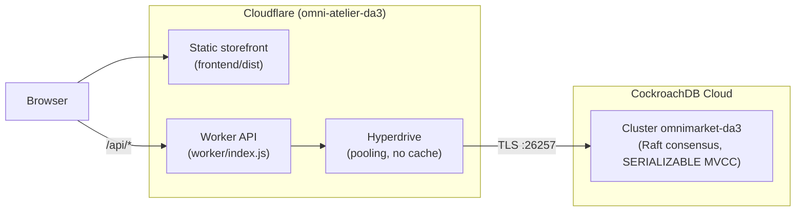

# System Architecture (Digital Assignment 3)

OmniMarket Atelier is a multi-vendor e-commerce platform built as three tiers:

1. **Presentation tier:** a Vite-built storefront (vanilla ES modules) served as static assets by Cloudflare.
2. **API tier:** a Cloudflare Worker (`frontend/worker/index.js`) that implements every `/api/*` endpoint with
   parameterized SQL through the `postgres.js` driver.
3. **Data tier:** a CockroachDB Cloud cluster (`omnimarket-da3`, GCP asia-southeast1), reached through
   Cloudflare Hyperdrive, which pools connections close to the database. Query caching is disabled so stock
   and order data are never stale.

## Request Flow: Checkout

1. The storefront posts the cart to `POST /api/orders`.
2. The Worker opens a transaction (`sql.begin`) and, for each line: reads price and stock, inserts the order and
   line items, locks the product row with `SELECT ... FOR UPDATE`, and decrements stock with a guarded
   `UPDATE ... WHERE stock >= qty`.
3. It inserts the payment and commits. Any error rolls back the whole transaction.
4. A SERIALIZABLE conflict (SQLSTATE `40001`) retries the transaction, up to 3 attempts.

## Schema Bootstrap

`database/schema.sql` and `database/seed.sql` are bundled into the Worker. On the first request against an
empty database the Worker creates any missing tables and seeds an empty `roles` table; both steps are
idempotent, so an interrupted first run is completed by the next request. The same files are applied locally
with `crdb-cli.cmd init`.

## Security Boundaries

- Bound parameters for all values; whitelisted table names; column names validated against `information_schema`.
- Public SQL console and EXPLAIN run in a verified `READ ONLY` transaction.
- Professor INSERT / UPDATE / DELETE require the `ADMIN_API_KEY` Worker secret.
- Database credentials live only in the Hyperdrive configuration, never in the repository or the browser.

## Offline Fallback

If the API is unreachable, `src/services/api.js` serves a bundled catalog and simulated responses so the
storefront still renders. Real API errors (validation, stock, authorization) are always shown as errors.
