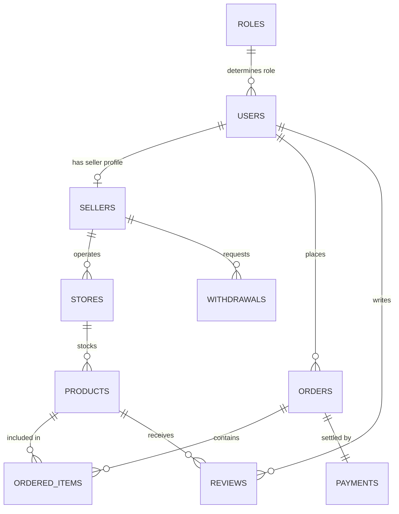

# Database Design & Distributed Architecture Specification

## 1. Entity-Relationship Model

---

## 2. Relational Schema & Table Specifications

### 2.1 Table: `roles`
Stores access control roles within the multi-vendor marketplace.
- `id` (SERIAL PRIMARY KEY)
- `role_name` (VARCHAR(50) NOT NULL UNIQUE)
  - Values: `Administrator`, `Seller`, `Buyer`

### 2.2 Table: `users`
Stores user identities, contact credentials, and membership status.
- `user_id` (SERIAL PRIMARY KEY)
- `role_id` (INT NOT NULL, FK -> `roles.id` ON UPDATE CASCADE ON DELETE RESTRICT)
- `first_name` (VARCHAR(50) NOT NULL)
- `last_name` (VARCHAR(50) NOT NULL)
- `email` (VARCHAR(100) NOT NULL UNIQUE)
- `password` (VARCHAR(255) NOT NULL)
- `phone` (VARCHAR(20))
- `status` (VARCHAR(30) DEFAULT 'active' CHECK (status IN ('active', 'inactive', 'suspended', 'pending')))
- `created_at` (TIMESTAMPTZ DEFAULT CURRENT_TIMESTAMP)

### 2.3 Table: `sellers`
Stores vendor merchant profiles linked to user accounts.
- `id` (SERIAL PRIMARY KEY)
- `user_id` (INT NOT NULL UNIQUE, FK -> `users.user_id` ON UPDATE CASCADE ON DELETE CASCADE)
- `store_name` (VARCHAR(100) NOT NULL)
- `description` (TEXT)
- `status` (VARCHAR(30) DEFAULT 'active' CHECK (status IN ('active', 'inactive', 'pending')))
- `created_at` (TIMESTAMPTZ DEFAULT CURRENT_TIMESTAMP)

### 2.4 Table: `stores`
Stores physical and virtual boutique storefront outlets operated by sellers.
- `id` (SERIAL PRIMARY KEY)
- `seller_id` (INT NOT NULL, FK -> `sellers.id` ON UPDATE CASCADE ON DELETE CASCADE)
- `name` (VARCHAR(100) NOT NULL)
- `rating` (NUMERIC(3,2) DEFAULT 5.00 CHECK (rating >= 0.0 AND rating <= 5.0))
- `status` (VARCHAR(30) DEFAULT 'active' CHECK (status IN ('active', 'inactive', 'under_review')))
- `city` (VARCHAR(50))
- `address` (VARCHAR(255))

### 2.5 Table: `products`
Stores inventory items offered by stores.
- `id` (SERIAL PRIMARY KEY)
- `store_id` (INT NOT NULL, FK -> `stores.id` ON UPDATE CASCADE ON DELETE CASCADE)
- `name` (VARCHAR(100) NOT NULL)
- `price` (NUMERIC(10,2) NOT NULL CHECK (price >= 0.0))
- `stock` (INT NOT NULL CHECK (stock >= 0))
- `description` (TEXT)

### 2.6 Table: `orders`
Stores customer sales orders.
- `id` (SERIAL PRIMARY KEY)
- `user_id` (INT NOT NULL, FK -> `users.user_id` ON UPDATE CASCADE ON DELETE CASCADE)
- `status` (VARCHAR(30) DEFAULT 'pending' CHECK (status IN ('pending', 'processing', 'completed', 'cancelled')))
- `total_price` (NUMERIC(10,2) NOT NULL CHECK (total_price >= 0.0))

### 2.7 Table: `ordered_items`
Stores line item details for each order.
- `id` (SERIAL PRIMARY KEY)
- `order_id` (INT NOT NULL, FK -> `orders.id` ON UPDATE CASCADE ON DELETE CASCADE)
- `product_id` (INT NOT NULL, FK -> `products.id` ON UPDATE CASCADE ON DELETE RESTRICT)
- `qty` (INT NOT NULL CHECK (qty > 0))
- `price` (NUMERIC(10,2) NOT NULL CHECK (price >= 0.0))

### 2.8 Table: `payments`
Stores financial settlement records for orders.
- `pay_id` (SERIAL PRIMARY KEY)
- `order_id` (INT NOT NULL UNIQUE, FK -> `orders.id` ON UPDATE CASCADE ON DELETE CASCADE)
- `amount` (NUMERIC(10,2) NOT NULL CHECK (amount > 0.0))
- `paid_at` (TIMESTAMPTZ DEFAULT CURRENT_TIMESTAMP)
- `pay_method` (VARCHAR(30) NOT NULL CHECK (pay_method IN ('UPI', 'Credit Card', 'Debit Card', 'NetBanking', 'Wallet')))
- `pay_status` (VARCHAR(30) DEFAULT 'completed' CHECK (pay_status IN ('completed', 'pending', 'failed', 'refunded')))

### 2.9 Table: `withdrawals`
Stores seller revenue payout requests.
- `id` (SERIAL PRIMARY KEY)
- `seller_id` (INT NOT NULL, FK -> `sellers.id` ON UPDATE CASCADE ON DELETE CASCADE)
- `amount` (NUMERIC(10,2) NOT NULL CHECK (amount > 0.0))
- `status` (VARCHAR(30) DEFAULT 'pending' CHECK (status IN ('pending', 'under_review', 'completed', 'rejected')))
- `req_at` (TIMESTAMPTZ DEFAULT CURRENT_TIMESTAMP)

### 2.10 Table: `reviews`
Stores customer feedback and product ratings.
- `id` (SERIAL PRIMARY KEY)
- `user_id` (INT NOT NULL, FK -> `users.user_id` ON UPDATE CASCADE ON DELETE CASCADE)
- `product_id` (INT NOT NULL, FK -> `products.id` ON UPDATE CASCADE ON DELETE CASCADE)
- `comment` (TEXT NOT NULL)

---

## 3. Secondary Performance Indexes

Secondary indexes are explicitly defined to accelerate frequent query filter paths and relational joins:

1. `idx_users_role_id` on `users(role_id)`: Accelerates RBAC role lookups.
2. `idx_stores_seller_id` on `stores(seller_id)`: Accelerates multi-store queries for a given vendor.
3. `idx_products_store_id` on `products(store_id)`: Eliminates full table scans during catalog filtering by store.
4. `idx_products_price` on `products(price)`: Optimizes catalog price range filtering.
5. `idx_orders_user_id` on `orders(user_id)`: Accelerates patron order history queries.
6. `idx_ordered_items_order_id` on `ordered_items(order_id)`: Enables sub-millisecond line item joins.
7. `idx_payments_order_id` on `payments(order_id)`: Facilitates 1-to-1 order settlement lookups.
8. `idx_reviews_product_id` on `reviews(product_id)`: Accelerates product reviews matrix loading.

---

## 4. CockroachDB Distributed SQL Concepts

### 4.1 Range Partitioning & Multi-Raft Consensus
- CockroachDB divides table data into ordered 64MB **Ranges**.
- Each range is replicated across multiple nodes (typically 3 or 5 replicas) forming an independent **Raft Consensus Group**.
- When an INSERT or UPDATE occurs, the Raft leader writes to its write-ahead log (WAL) and replicates the log entry to followers. Once a quorum (2 out of 3 replicas) acknowledges the write, the transaction commits.

### 4.2 Serializable Isolation Level
Unlike traditional databases that default to READ COMMITTED, CockroachDB strictly enforces **SERIALIZABLE** isolation. It uses:
1. **Multi-Version Concurrency Control (MVCC):** Reads never block writes, and writes never block reads.
2. **Hybrid Logical Clocks (HLC):** Coordinates transaction sequencing across distributed nodes without requiring expensive specialized hardware like Google Spanner's atomic clocks.
