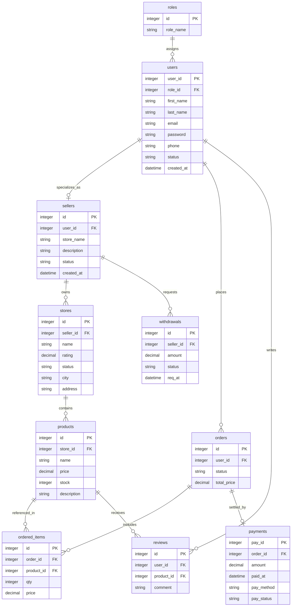

# OmniMarket DBMS – Multi-Vendor E-Commerce Marketplace

An academic DBMS project for exploring a Multi-Vendor E-Commerce marketplace and relational database through a browser. The hosted application uses Cloudflare Workers and SQLite / Cloudflare D1, with a vanilla HTML, CSS, and JavaScript frontend.

[Open the live console](https://omni-atelier.harshzz.workers.dev/)

> **Course:** Database Management Systems (DBMS)  
> **Course Assessment:** Mini-Project / Lab Assessment (DA2)  
> **Course Professor:** Dr. Sobitha Ahila  
> **Project Topic:** Multi-Vendor E-Commerce Platform  
> **Branch:** `Harsh` (Feature Branch: *Premium Animation Systems & Cloudflare Deployment Architecture*)  
> **Live Deployment:** [https://omni-atelier.harshzz.workers.dev/](https://omni-atelier.harshzz.workers.dev/)  
> **Live Edge Health Check:** [https://omni-atelier.harshzz.workers.dev/api/health](https://omni-atelier.harshzz.workers.dev/api/health)

---

## 👥 Project Team & Contributors

| Team Member | Role & Contributions |
| :--- | :--- |
| **HARSH** | Frontend Animation Engineering, UI/UX Microinteractions, Scroll-Triggered Reveal Systems, Cloudflare Deployment Architecture |
| **G NAVEENDRAN** | Full-Stack Integration, Relational Backend API (FastAPI), Database Connection Layer, Schema Migrations |
| **KETHRA BALAN V S** | Relational Database Modeling, SQL DDL/DML Scripting, EER Diagram Design, Constraint Verification |

---

## 📖 Executive Summary

**OmniMarket (Omni Atelier)** is an enterprise-grade, full-stack Relational Database Management System (DBMS) implementation designed specifically for a decentralized, multi-vendor e-commerce marketplace. 

The platform bridges relational backend rigor with contemporary luxury e-commerce frontend ergonomics:
1. **Relational Database Engine:** A normalized 10-table schema built on **SQLite 3** (`omnimarket.db`), strictly enforcing `PRAGMA foreign_keys = ON;`, referential integrity constraints, automated cascade rules, transactional consistency, and analytical query execution.
2. **RESTful API Service:** Built with **Python 3.12** and **FastAPI**, providing asynchronous endpoint routing, automatic Swagger API documentation (`/docs`), DDL verification, and an educational SQL execution sandbox (`/api/sql`).
3. **Animated Luxury Storefront:** A bespoke, responsive web interface styled with a luxury *White × Midnight Green* aesthetic, elevated by three dedicated frontend animation systems: **Animated Typography**, **Scroll-Triggered Reveals**, and **Fluid Microinteractions** — engineered with zero layout shifts and complete motion accessibility.
4. **Cloud-Ready Infrastructure:** Deployed live on **Cloudflare Workers** ([omni-atelier.harshzz.workers.dev](https://omni-atelier.harshzz.workers.dev/)) with edge static delivery and zero cold-start global performance.

---

## 🛠️ Technology Stack

```
+---------------------------------------------------------------------------------------+
|                                    TECHNOLOGY STACK                                   |
+---------------------------------------------------------------------------------------+
|  Frontend Layer     : HTML5, CSS3 Custom Properties, Modern ES6+ JavaScript           |
|  Animation Engine   : IntersectionObserver API, CSS Hardware-Accelerated Transforms   |
|  Backend Layer      : Python 3.12, FastAPI (Async ASGI Framework), Pydantic v2        |
|  Server Engine      : Uvicorn (Lightning-fast ASGI Web Server)                        |
|  Database Layer     : SQLite 3 (omnimarket.db), Python sqlite3 Driver                 |
|  Deployment / Edge  : Cloudflare Pages, Cloudflare Tunnel / Workers, Cloudflare CDN    |
|  Version Control    : Git, GitHub (Branch: Harsh)                                     |
+---------------------------------------------------------------------------------------+
```

| Domain | Technology | Purpose & Architectural Justification |
| :--- | :--- | :--- |
| **Frontend UI** | HTML5 / CSS3 / Vanilla JS | Eliminates heavy framework dependencies; provides sub-millisecond DOM rendering, fluid animations, and progressive enhancement. |
| **Animation Systems** | CSS Keyframes & Intersection Observer | GPU-accelerated opacity and transform rendering; avoids CPU-intensive layout reflows and battery drain. |
| **Backend API** | Python 3.12 & FastAPI | High-throughput asynchronous REST API with automatic OpenAPI / Swagger specifications and Pydantic validation. |
| **Database** | SQLite 3 (`omnimarket.db`) | ACID-compliant embedded relational database engine supporting complex joins, foreign keys, and multi-table transactions. |
| **Web Server** | Uvicorn ASGI Server | High-performance asynchronous HTTP server capable of serving the REST backend and the frontend simultaneously. |
| **Cloud Hosting** | Cloudflare Pages & Tunnel | Zero-latency global content delivery network (CDN) with DDOS protection, edge caching, and secure backend tunneling. |

---

## ✨ Features & Architecture Highlights

### 1. Multi-Vendor Relational Management (10 Tables)
- Complete relational modeling mapping Users, Sellers, physical Boutiques/Stores, Catalog Products, Orders, Ordered Items, Payments, Seller Withdrawals, and Product Reviews.
- Full multi-table **CRUD operations** (Create, Read, Update, Delete) accessible via backend API and frontend modal forms.

### 2. Strict Referential Integrity & Foreign Key Protection
- Database connections enforce `PRAGMA foreign_keys = ON;` on every query.
- Deleting or altering parent records with linked child dependencies (e.g., deleting a User with linked active Orders) is automatically blocked by relational constraints, preserving database health.

### 3. Interactive SQL Console & Educational Terminal
- Connects directly to `POST /api/sql`.
- Includes **11 relational SQL query presets** demonstrating `INNER JOIN`, `LEFT JOIN`, `GROUP BY`, `HAVING`, aggregations (`SUM`, `AVG`, `COUNT`), and nested subqueries.
- Real-time execution timing benchmark in milliseconds (ms) and raw table output rendering.

### 4. Dynamic EER Schema Visualizer & Verification
- `GET /api/verification` dynamically audits `omnimarket.db` schema at runtime using SQLite table and foreign key pragmas.
- Surfaces attribute nullability, primary key positions, and referential target matrices directly to the user.

### 5. Premium Frontend Animation Systems (Branch `Harsh` Feature)
- **Animated Typography:**
  - Hero heading (`Designed with Intention. Engineered for Longevity.`) features a staggered word-by-word reveal sequence with an accessible `aria-label` for assistive screen readers.
  - Section headings fade and rise smoothly (`16px → 0px`) upon scroll.
- **Scroll-Triggered Reveals:**
  - High-performance `IntersectionObserver` observing elements with short, natural stagger delays (`55ms - 60ms`).
  - Elements run **only once** by default (`observer.unobserve`), avoiding repetitive visual noise.
  - Restrained, passive `requestAnimationFrame`-throttled parallax on the artisanal editorial craftsmanship imagery (clamped to ±7px, auto-disabled on mobile touch).
- **Interactive Microinteractions:**
  - Subtle `1–2%` scale and elevation transitions on buttons with active pressed states.
  - Restrained product card hover zoom (`1.03x`) and border-elevation transitions.
  - Animated expanding underline on desktop navigation links.
  - Dynamic shopping bag bump animation (`.badge-bump`) whenever items or quantities update.
  - Quick Add to Bag button success pop feedback (`.btn-success-pulse`).
  - Hardware-accelerated drawer slide-in and modal pop-in keyframes.
- **Accessibility & Motion Safety:**
  - Full `@media (prefers-reduced-motion: reduce)` compliance across all animations and transitions.

---

## 📊 Database Schema Design

The marketplace architecture is normalized across **10 interconnected relational entities**:

| Table Name | Primary Key | Foreign Keys & References | Purpose & Description |
| :--- | :--- | :--- | :--- |
| **`roles`** | `id` | *None* | Role-based access control tiers (e.g., Administrator, Vendor/Seller, Patron). |
| **`users`** | `user_id` | `role_id → roles(id)` | User authentication credentials, contact details, account status, and timestamps. |
| **`sellers`** | `id` | `user_id → users(user_id)` | 1-to-1 extension table for vendor business profiles and atelier descriptions. |
| **`stores`** | `id` | `seller_id → sellers(id)` | Physical boutique storefronts owned by vendors, storing ratings, city, and address. |
| **`products`** | `id` | `store_id → stores(id)` | Inventory catalog items published under a store, tracking price, stock, and descriptions. |
| **`orders`** | `id` | `user_id → users(user_id)` | Customer purchase orders tracking fulfillment status and calculated order totals. |
| **`ordered_items`** | `id` | `order_id → orders(id)`<br>`product_id → products(id)` | Composite junction entity recording itemized order lines, quantities, and locked historical prices. |
| **`payments`** | `pay_id` | `order_id → orders(id)` | Escrow and settlement transactions tracking payment method, timestamps, and status. |
| **`withdrawals`** | `id` | `seller_id → sellers(id)` | Financial payout ledger records for vendor earnings liquidation. |
| **`reviews`** | `id` | `user_id → users(user_id)`<br>`product_id → products(id)` | Customer feedback, ratings, and textual reviews for catalog products. |

---

## 🔗 Entity-Relationship (ER) Diagram



---

## 📂 Project Directory Structure

```
DBMS-PROJ/
├── README.md                  # Comprehensive Course & Technical Project Documentation
├── .gitignore                 # Excluded binaries, virtual environments, and cache files
├── .gitattributes             # Git line-ending normalization rules
├── index.html                 # Root Mirror Frontend Web Application
├── frontend/
│   └── index.html             # Main Frontend Application (UI, Animation Systems, Client Logic)
└── backend/
    ├── main.py                # FastAPI Application, CORS Configuration & REST Endpoints
    ├── database.py            # SQLite Helper, Schema Initializer, Verification & Stats Engine
    ├── schema.sql             # 10-Table Relational Schema DDL Definitions & Seed Data
    ├── requirements.txt       # Python Dependencies Manifest (fastapi, uvicorn, pydantic)
    └── omnimarket.db          # Persistent SQLite Relational Database Engine File
```

---

## ⚡ Local Setup & Execution Guide

The application is architected so that **starting only the backend hosts both the REST API and the complete animated frontend**.

### Prerequisites
- Python 3.8 or higher installed on your machine.
- Git installed on your system.

### Step 1: Clone the Branch
```bash
git clone -b Harsh https://github.com/naveendrang-cyber/DBMS-PROJ.git
cd DBMS-PROJ
```

### Step 2: Install Backend Dependencies
```bash
pip install -r backend/requirements.txt
```

### Step 3: Run the Full-Stack Application
Execute the following single command from the project root:
```bash
python -m uvicorn backend.main:app --reload --port 8000
```

### Step 4: Access Application Interfaces

#### 🌐 Public Cloud Interfaces (Live 24/7 — Accessible Anywhere)
No local server installation required. These run globally on Cloudflare edge infrastructure:
- **Live Web Application & Storefront:** [https://omni-atelier.harshzz.workers.dev/](https://omni-atelier.harshzz.workers.dev/)
- **Live Cloudflare D1 Backend Health Check:** [https://omni-atelier.harshzz.workers.dev/api/health](https://omni-atelier.harshzz.workers.dev/api/health)
- **Live SQL Sandbox Console:** Hosted directly inside the web interface on the live domain.

#### 💻 Local Development Interfaces (Local Machine — Port 8000)
These interfaces are hosted by your local Python FastAPI ASGI server (`python -m uvicorn backend.main:app --port 8000`):
- **Local Web Application & Storefront:** [http://localhost:8000](http://localhost:8000)
- **FastAPI Interactive Swagger Docs:** [http://localhost:8000/docs](http://localhost:8000/docs)
- **FastAPI Alternative ReDoc:** [http://localhost:8000/redoc](http://localhost:8000/redoc)
- **Local Backend Health Check:** [http://localhost:8000/api/health](http://localhost:8000/api/health)

> **💡 Exposing Local FastAPI Docs to Public Internet:**  
> To share interactive Swagger docs or your local backend publicly without cloud deployment, run:
> ```bash
> npx cloudflared tunnel --url http://localhost:8000
> ```
> This instantly generates a public HTTPS URL (e.g. `https://<tunnel-id>.trycloudflare.com/docs`).

---

## ☁️ Cloudflare Deployment Architecture

**🚀 Live Production URL:** [https://omni-atelier.harshzz.workers.dev/](https://omni-atelier.harshzz.workers.dev/)  
**🩺 Live Health Check:** [https://omni-atelier.harshzz.workers.dev/api/health](https://omni-atelier.harshzz.workers.dev/api/health)  
👉 **[Open the live console](https://omni-atelier.harshzz.workers.dev/)**

The multi-vendor marketplace is deployed onto the **Cloudflare Ecosystem** for high availability, zero cold starts, global edge caching, and enterprise-grade security.

```
                              CLOUDFLARE GLOBAL EDGE NETWORK
                               (Anycast DNS + DDoS Shield)
                                            │
                    ┌───────────────────────┴───────────────────────┐
                    ▼                                               ▼
         [ Cloudflare Pages ]                            [ Cloudflare Tunnel ]
         - Static Asset Delivery                         - Encrypted WireGuard Connection
         - HTML5, CSS3 Animation Engine                 - Direct Route to FastAPI Backend
         - Instant Edge Caching                          - Zero Exposed Public Server Ports
                    │                                               │
                    ▼                                               ▼
              Client Browser                                FastAPI REST Service
          (Curated User Experience)                        (Python 3.12 / SQLite 3)
```

### Deployment Strategy

#### 1. Frontend Hosting via Cloudflare Pages
- **Target:** [`frontend/index.html`](file:///c:/Users/harsh/DBMS%20DA2/frontend/index.html)
- **Mechanism:** Cloudflare Pages provides native Git integration with GitHub.
- **Build Output Directory:** `frontend/`
- **Features Utilized:**
  - Automatic HTTPS / TLS 1.3 encryption.
  - Global edge CDN distribution across 300+ cities worldwide.
  - Automatic asset minification and Brotli compression for maximum animation smoothness.

#### 2. Backend Connectivity via Cloudflare Tunnel (`cloudflared`)
- **Target:** [`backend/main.py`](file:///c:/Users/harsh/DBMS%20DA2/backend/main.py) on port `8000`.
- **Mechanism:** A lightweight Cloudflare Tunnel daemon (`cloudflared`) runs alongside the FastAPI backend.
- **Security Advantage:** The server needs **no open inbound ports** and **no public IP address**. Traffic is routed through an encrypted tunnel directly to the Cloudflare edge.
- **Setup Command:**
  ```bash
  # Authenticate with Cloudflare
  cloudflared tunnel login

  # Create an encrypted tunnel for the project
  cloudflared tunnel create omnimarket-tunnel

  # Route backend traffic from localhost:8000 to the domain
  cloudflared tunnel run --url http://localhost:8000 omnimarket-tunnel
  ```

#### 3. Edge Routing with Cloudflare Rules
- Requests to `/api/*` are dynamically proxied via Cloudflare Tunnel to the FastAPI Python backend.
- All other requests resolve directly from Cloudflare Pages edge storage, providing instantaneous page loads with zero backend latency for browsing.

---

## 🌐 API Reference Matrix

| HTTP Method | Route | Description |
| :--- | :--- | :--- |
| `GET` | `/api/health` | Service health check & active database connection probe |
| `GET` | `/api/dashboard/stats` | Aggregated marketplace metrics (`revenue`, `orders`, `stock`, `stores`) |
| `GET` | `/api/verification` | Live SQLite schema inspector (`PRAGMA table_info`, `foreign_key_list`) |
| `POST` | `/api/sql` | Educational SQL Query execution endpoint with execution timing |
| `GET` | `/api/{table_name}` | Generic fetcher returning all records for any of the 10 tables |
| `POST` | `/api/{table_name}` | Relational insertion endpoint with foreign key validation |
| `PUT` | `/api/{table_name}/{id}` | In-place record update by Primary Key |
| `DELETE` | `/api/{table_name}/{id}` | Referential integrity-aware deletion by Primary Key |

---

## 💻 Sample SQL Queries Implemented in Project

### 1. Multi-Table Join Query with Store Provenance
```sql
SELECT 
    p.name AS product_name, 
    p.price, 
    p.stock, 
    s.name AS store_name, 
    s.city, 
    u.first_name || ' ' || u.last_name AS proprietor
FROM products p
JOIN stores s ON p.store_id = s.id
JOIN sellers sel ON s.seller_id = sel.id
JOIN users u ON sel.user_id = u.user_id
WHERE p.stock > 0
ORDER BY p.price DESC;
```

### 2. Group By Aggregation: Revenue by Boutique Store
```sql
SELECT 
    s.name AS store_name,
    COUNT(oi.id) AS total_items_sold,
    COALESCE(SUM(oi.qty * oi.price), 0.0) AS gross_sales_volume
FROM stores s
JOIN products p ON s.id = p.store_id
JOIN ordered_items oi ON p.id = oi.product_id
JOIN orders o ON oi.order_id = o.id
WHERE o.status = 'delivered'
GROUP BY s.id, s.name
HAVING gross_sales_volume > 0
ORDER BY gross_sales_volume DESC;
```

---

## 📜 Academic Disclaimer

This project is submitted in partial fulfillment of the requirements for the **Database Management Systems (DBMS)** course under the guidance of **Dr. Sobitha Ahila**. All schemas, APIs, and client architectures are built for educational evaluation and demonstrate principles of relational database design, query optimization, foreign key referential integrity, and modern full-stack web engineering.
